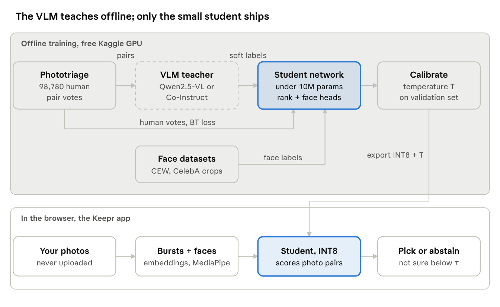
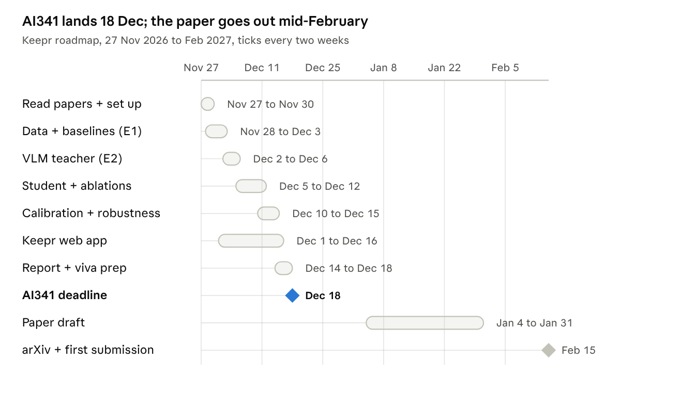

# Keepr — Research Roadmap & Paper Plan

<!--
  Versioned planning doc. The Markdown file is the source of truth for diffs;
  the PDF next to it is a snapshot of the same version. See docs/planning/README.md.
-->
> **Version 1.2** · 28 Nov 2026 · Live doc: https://claude.ai/artifact/2G1AJK548T3SncNZAPDrsd · PDF snapshot: [`Keepr_Research_Roadmap_v1.2.pdf`](Keepr_Research_Roadmap_v1.2.pdf)
> Scope: AI341 project first; paper drafting is deferred until after 18 Dec 2026. Changes since 1.0: [CHANGELOG](CHANGELOG.md).
> **Compute:** lab RTX A2000 (12 GB) for long jobs and the VLM teacher, plus Kaggle T4 (30 h/week for each of 3 teammates) for parallel runs. No 4090.


## TL;DR

**The paper:** teach a tiny on-device model to pick the best photo in a series by copying a large vision-language model (VLM), and make it honest about when it isn't sure.

**Working title:** *Know When It's a Toss-Up: Distilling Vision-Language Models into Calibrated, On-Device Series Photo Selection.*

**The gap in one breath:** series photo selection has been studied since 2016 on Phototriage. The newest work (FGAesthetics, March 2026) re-annotated it and reached 77.9% pair accuracy with an 86M-parameter CLIP model, and tested 7–8B VLM scorers (about 71%). Every strong model is 86M+ parameters, none reports whether its confidence can be trusted, and none can say "these two are a toss-up". Humans often can't decide either: crowd votes split on many pairs, and photo owners agree with the crowd only about 65% of the time.

**The claim we will test:** a student under 10M parameters, distilled from human votes plus an order-debiased VLM teacher, reaches at least 95% of the accuracy of an 86M CLIP ViT-B baseline we train on the same Phototriage split, runs on-device, and has confidence that matches the human vote split. That lets it abstain on exactly the pairs people themselves disagree on.

**What you walk away with:** the AI341 project (18 Dec), an arXiv preprint plus a conference or workshop submission (Jan–Mar 2027), and the Keepr app.

## Crash course: the 10 ideas you need

You already know a CNN turns an image into features and then a prediction. Everything below builds on that, in the order you'll meet it.

1.  **Pretrained backbone + transfer learning.** Someone already trained a CNN (e.g. EfficientNet) on millions of images. We keep its feature layers (the *backbone*) and train only a small new layer on top (the *head*) for our task. That's why we can train on a free GPU.

2.  **Embeddings.** The backbone's output is a vector, a numeric summary of the photo. Similar photos get nearby vectors, so we group bursts by clustering vectors that are close together.

3.  **Multi-task heads.** One backbone, several small heads: eyes open?, face sharp?, looking at camera?, smiling?, face covered? One shared CNN pass answers all of them.

4.  **Siamese network + pairwise ranking.** Instead of asking "is this photo good?", we ask "is A better than B?". The *same* network scores both photos, and the loss pushes the human-preferred photo's score higher. The maths (Bradley–Terry) turns a score gap into a probability:

```latex
P(A \succ B) = \sigma(s_A - s_B) = \frac{1}{1 + e^{-(s_A - s_B)}}
```

5.  **Vision-language model (VLM).** A huge model that reads an image plus a question and answers in text (e.g. Qwen2.5-VL). We show it two photos and ask "which is better, A or B?". Its internal probability for the token "A" vs "B" is a *soft label*, e.g. 0.8 for A.

6.  **Knowledge distillation.** The small *student* learns to copy the big *teacher's* soft labels, not just hard 0/1 answers. Soft labels carry more information ("A is slightly better"). We weight each pair by how confident the teacher was, so the student ignores coin-flip answers.

7.  **Self-supervised learning (DINOv2).** A backbone pretrained *without labels* by learning to match different views of the same image. Its features are strong for fine visual details, which suits subtle burst differences.

8.  **Calibration.** If the model says "80% sure" 100 times, it should be right about 80 times. ECE (expected calibration error) measures the gap. **Temperature scaling** fixes most of it by dividing the logits by one number T, fitted on validation data.

```latex
\mathrm{ECE} = \sum\_{b=1}^{B} \frac{n_b}{N} \left\| \mathrm{acc}(b) - \mathrm{conf}(b) \right\|
```

9.  **Selective prediction (abstaining).** If confidence is below a threshold, the model says "not sure" and the photo goes to manual review. We report a *risk–coverage curve*: how accuracy rises as the model answers fewer cases.

10. **Distribution shift + Grad-CAM.** Shift: test photos (night, phone, groups) differ from training photos, and accuracy drops. Grad-CAM is a heatmap of which pixels drove a prediction, so we can check the model looks at eyes, not the background.

**Read first, in this order (about 1 hour each):** Chang 2016 (Photo Triage) → LEAF 2026 (MLLM → student distillation) → Co-Instruct 2024 (VLMs comparing images) → Calibrated Selective Classification 2022. Skim the abstract, the figures, then the method section.

## Literature review

Four research lines meet in this project, and none of the papers we found joins all four: series photo selection, VLM-based quality judgement, distillation into small models, and calibrated abstention.

| Paper                                                                                                                                | Year, venue              | What it does                                                                                                                                   | What it leaves open                                             |
|--------------------------------------------------------------------------------------------------------------------------------------|--------------------------|------------------------------------------------------------------------------------------------------------------------------------------------|-----------------------------------------------------------------|
| [Automatic Triage for a Photo Series](https://gfx.cs.princeton.edu/pubs/Chang_2016_ATF/chang2016-triage-preprint.pdf) (Chang et al.) | 2016, SIGGRAPH / ACM TOG | Phototriage dataset: 15,545 photos in 5,953 series, 98,780 crowd preferences. VGG Siamese reaches 73% pair accuracy; best generic baseline 57% | Pre-VLM; no calibration; no face-state modelling                |
| [Real-time Burst Photo Selection](https://arxiv.org/pdf/1803.07212) (Wang et al., Microsoft)                                         | 2018                     | Light-head network picks the best burst frame: 0.47 MB, 13 ms on iPhone 7                                                                      | Own burst data; no VLM, no calibration                          |
| [SPS via Multi-view Graph Learning](https://arxiv.org/html/2203.09736) (Huang et al.)                                                | 2022                     | Graph + self-attention over multiple feature views, Siamese ranking on Phototriage                                                             | Accuracy only; large VGG features                               |
| [Modeling Multiple Aesthetic Views for SPS](https://ieeexplore.ieee.org/document/10168263/) (SPSNet)                                 | 2023, IEEE               | Deep + shallow + handcrafted features; 75.36% on Phototriage                                                                                   | Same gaps                                                       |
| [Feature Disentanglement for SPS](https://dl.acm.org/doi/10.1109/TMM.2024.3382469)                                                   | 2024, IEEE TMM           | Separates label-relevant features to highlight subtle differences                                                                              | Same gaps                                                       |
| [Group photo aesthetics](https://arxiv.org/pdf/2002.01096v1.pdf)                                                                     | 2020                     | Hand-designed features: open eyes, gaze, smile, occlusion                                                                                      | Handcrafted; single images, not series                          |
| [Group photo ranking (rGroup)](https://arxiv.org/pdf/2006.03898.pdf)                                                                 | 2020                     | Ranks group photos with emotion + aesthetics + quality                                                                                         | Tiny set: 70 sets of 3 images                                   |
| [All Smiles](https://research.google/pubs/pub41101/) (Google)                                                                        | 2012, CVMP               | Scores faces, then swaps in each person's best face from other frames                                                                          | Pre-deep-learning; composite, not selection                     |
| [Burst Image Quality Assessment](https://arxiv.org/abs/2511.07958) (BuIQA)                                                           | 2026, AAAI               | 7,346 burst sequences, 45,827 images; task-aware prompt tuning                                                                                 | Targets downstream tasks (denoising etc.), not human preference |
| [Q-Align](https://arxiv.org/abs/2312.17090)                                                                                          | 2024, ICML               | Teaches VLMs to score quality via text levels (bad → excellent)                                                                                | Single image; large model                                       |
| [Co-Instruct](https://arxiv.org/abs/2402.16641)                                                                                      | 2024, ECCV oral          | VLM for comparing multiple images; 80.18% on Q-Bench pairs                                                                                     | Quality comparison only; not series preference; large           |
| [DepictQA](https://arxiv.org/html/2312.08962.pdf)                                                                                    | 2024, ECCV               | Describes and compares quality in language                                                                                                     | Large; no deployment                                            |
| [LEAF](https://arxiv.org/html/2601.20689)                                                                                            | 2026, arXiv              | Frozen InternVL-3.5-8B teacher → ConvNeXt-Base (88.6M) student; point-wise + confidence-weighted pair-wise distillation                        | Single-image IQA; no series, faces, ECE or on-device numbers    |
| [VLM knowledge distillation for IQA](https://pith.science/paper/2507.15680)                                                          | 2025                     | Distils CLIP quality knowledge into a lightweight student                                                                                      | Single image; no series or calibration                          |
| [PhotoEye / PhotoBench](https://arxiv.org/html/2509.18582v1)                                                                         | 2025                     | Teaches MLLMs to critique photos like photographers                                                                                            | Critique, not selection; large                                  |
| [Calibrated Selective Classification](https://arxiv.org/abs/2208.12084v2) (Fisch et al.)                                             | 2022                     | Abstain on uncertain inputs while keeping accepted predictions calibrated, robust to shift                                                     | Generic classification; never applied to photo selection        |
| [Reliable VQA: Abstain Rather Than Answer](https://arxiv.org/pdf/2204.13631)                                                         | 2022                     | Learned selection function for when a VQA model should abstain                                                                                 | VQA, not ranking                                                |

**Closest recent work, found in the gap check (2025–2026):**

| Paper                                                                                                         | What it does                                                                                                                                                                                                                                                   | Why we are still different                                                                                                   |
|---------------------------------------------------------------------------------------------------------------|----------------------------------------------------------------------------------------------------------------------------------------------------------------------------------------------------------------------------------------------------------------|------------------------------------------------------------------------------------------------------------------------------|
| [FGAesthetics / FGAesQ](https://arxiv.org/html/2603.03907v1) (Mar 2026)                                       | 32,217 images in 10,028 series, 44,863 pairs judged by 10 annotators each; natural series built from Chang's data. CLIP ViT-B/16 model (86.3M) reaches 0.779 pair accuracy on natural series; VLM scorers reach 0.711 (Q-Align), 0.709 (UNIAA), 0.658 (RealQA) | No distillation, no calibration or ECE, no abstention, no on-device model; indistinguishable pairs are deleted, not modelled |
| [PSDistill](https://arxiv.org/html/2605.19776v1) (May 2026)                                                   | Turns VLM pairwise judgments into calibrated pseudo-scores, then trains the same VLM with confidence-weighted ranking into a one-pass aesthetic scorer                                                                                                         | The result is still a full VLM; single images, not series                                                                    |
| [Position bias in multi-image VLMs](https://arxiv.org/html/2503.13792v1) (Tian et al., 2025)                  | Changing the order of images changes VLM answers, even for GPT-4o                                                                                                                                                                                              | Motivates our order-swap debiasing of the teacher                                                                            |
| [TASTE](https://arxiv.org/pdf/2605.20731) (2026)                                                              | VLM judges on design preference: Qwen3-VL-4B at 0.53 accuracy, verdict unchanged after flipping order on 77.5% of pairs                                                                                                                                        | Evidence that raw VLM labels must be filtered                                                                                |
| [Real-time Burst Photo Selection, journal version](https://pubmed.ncbi.nlm.nih.gov/31804935/) (IEEE TIP 2019) | Model's pick matched users' top-1 in 64.1% of bursts (~11 frames) and top-3 in 86.2%                                                                                                                                                                           | Reference numbers for our user pilot                                                                                         |

**Products:** pro tools (Aftershoot, Imagen, Narrative, [Lightroom Assisted Culling](https://helpx.adobe.com/sg/lightroom-classic/desktop/organize-photos-in-lightroom-classic/assisted-culling.html)) and new small iOS apps ([Clear Pick](https://apps.apple.com/app/id6763069973), [Best Shot](https://apps.apple.com/us/app/id6757730398)) do on-device culling. None publish methods or calibration results.

## Evidence this will work

Each part of the plan has already worked on its own in published work; what's new is putting them together for series selection.

- **The task is learnable.** On Phototriage, a Siamese CNN reaches 73% pair accuracy where the best generic model gets 57%, and later work reaches 75.36%. A trained ranker clearly beats generic quality scores.

- **Small models are enough.** Microsoft's burst selector is 0.47 MB and runs in 13 ms per frame on an iPhone 7, far inside our 25M-parameter / 100 ms budget.

- **VLMs can judge image pairs, if chosen carefully.** Co-Instruct, tuned for comparisons, scores 80.18% on Q-Bench pairs and beats its GPT-4V teacher. The same paper shows a variant without comparison data at only about 53%. So the teacher must be one trained for comparing images, and we test that before relying on it.

- **VLM → small-student distillation works.** LEAF distils an 8B VLM into a ConvNeXt student with *no* human scores and reaches SRCC 0.777 on KonIQ and 0.861 on SPAQ (SRCC measures how well a predicted ranking matches the human ranking, 1.0 = identical). With 10% of labels it reaches 0.867 / 0.896. Its confidence-weighted pairwise loss is exactly what we need.

- **Face cues matter for people photos.** Group-photo work builds its quality model on open eyes, gaze, smile and occlusion, the same signals as our face heads.

<!-- -->

- **The bar is now clear.** On natural series, an 86M CLIP model reaches 0.779 pair accuracy and 7–8B VLM scorers 0.66–0.71 (FGAesthetics). That number is on FGAesthetics' re-annotated pairs, not Phototriage's, so we compare against our own CLIP ViT-B baseline on the same split; and a VLM teacher only needs to beat chance on the pairs it is confident about to help.

- **Pairwise human data supports calibration.** FGAesthetics treats a 50/50 vote as "no consensus" and 90/10 as a clear winner. That vote split is exactly the target a calibrated model should reproduce.

- **Users accept imperfect pickers.** Microsoft's burst model matched users' top-1 pick 64.1% of the time and top-3 86.2%; our user pilot can be judged against these numbers.

**Built-in ceiling (say this in the paper):** photo owners agreed with the crowd majority in only about 65% of series (358 of 551). Personal taste is real, so we claim to match *consensus* and catch *objective flaws*, not to read minds.

## Research gap and hypotheses

**Gap statement for the paper:** the strongest series-selection models are large (86M CLIP, 7–8B VLMs) and treat every pair as decidable. No work we found (1) brings them down to phone size for within-series ranking, (2) checks whether their confidence can be trusted, or (3) treats the pairs humans themselves split on as toss-ups the model should flag instead of guessing.

| Gap                      | Evidence it's open (checked 27 Nov 2026)                                                                                                                                                                                                                   | Our contribution                                                                                                                  |
|--------------------------|------------------------------------------------------------------------------------------------------------------------------------------------------------------------------------------------------------------------------------------------------------|-----------------------------------------------------------------------------------------------------------------------------------|
| G1. Efficiency           | State of the art: FGAesQ, 86.3M CLIP ViT-B/16; VLM scorers 7–8B; LEAF's student 88.6M, single images, no latency numbers; Microsoft's 0.47 MB model (2018) predates VLMs and uses its own data                                                             | Pairwise distillation from human votes + VLM teacher into a student under 10M; browser latency measured                           |
| G2. Trust (main novelty) | FGAesthetics, SPSNet, SPS-MVG and Chang 2016 report accuracy only; FGAesthetics deletes indistinguishable pairs while labelling instead of modelling them                                                                                                  | Calibrate model probability to the human vote split; ECE + risk–coverage; abstain on predicted toss-ups                           |
| G3. Teacher reliability  | VLMs change answers when image order changes, even GPT-4o (Tian et al., 2025); in a 2026 design-preference study, Qwen3-VL-4B's verdict stayed the same after flipping the images on 77.5% of pairs (decided by position, not content), with 0.53 accuracy | Measure position bias on photo series; keep only order-consistent, confident teacher labels; check the student inherits less bias |
| G4. Faces and intent     | Face cues appear only in single-image group-photo work; FGAesthetics doesn't analyse people photos separately                                                                                                                                              | Face-state heads; per-category results (portrait, group, selfie); deliberate-pose failure study                                   |

**Hypotheses (each becomes one results table):**

- **H1 (efficiency).** On Phototriage high-agreement test pairs, a student under 10M parameters reaches at least 95% of the pair accuracy of our own CLIP ViT-B/16 Siamese baseline (86M, trained on the same split) with at least 8× fewer parameters, and runs in under 100 ms per photo in the browser. FGAesQ's 0.779 is on FGAesthetics' re-annotated pairs, so it is quoted as context only, unless that data is released and we evaluate on it directly.

- **H2 (teacher).** Order-debiased, confidence-filtered VLM labels improve the student over human labels alone, even though the raw VLM scores lower than the student's target.

- **H3 (trust).** Training on soft vote fractions plus temperature scaling lowers ECE compared with hard 0/1 labels. Abstaining on the 20% least-confident pairs raises accuracy on the rest by at least 5 points, and this still holds on the shifted phone-photo set.

- **H4 (faces).** Face-state heads improve accuracy on portrait, group and selfie series, with no loss elsewhere.

**Honesty check:** "no prior work" means none that we found as of 27 Nov 2026. Re-run the searches (Google Scholar: "series photo selection", "photo triage" + VLM/MLLM, "distillation" + "photo selection") the week before you submit.

## Method

The big VLM only works offline, labelling photo pairs; the shipped model is a small CNN student that learns from human votes, VLM soft labels and face labels at once.



Keepr method · offline teacher, on-device student

**Student:** a backbone under 10M parameters (MobileNetV3 or EfficientNet-B0; DINOv2-S frozen as an ablation) with three heads: a global ranking score, face-state heads (eyes open, sharp, gaze, smile, occlusion) on MediaPipe face crops, and a small layer that fuses them into one score per photo.

**Face-head labels, with no VLM dependency and almost no hand labelling:**

- **Pre-train** on CEW (eyes open/closed) and CelebA attributes (Smiling, Blurry, Eyeglasses as a proxy for occlusion).

- **Pseudo-label Phototriage face crops:** eyes from an eye-aspect ratio on MediaPipe landmarks, with the threshold set on CEW; sharpness from Laplacian variance on crops resized to a fixed size; gaze from head-pose yaw and pitch; smile from the CelebA-trained head.

- **The VLM teacher adds smile and gaze labels only if it passes the flip test.**

- **Check set:** B hand-labels about 200 Phototriage face crops (a few hours) to measure pseudo-label and face-head accuracy, which the rubric needs.

**Training loss**, three parts added together:

```latex
L = \underbrace{\mathrm{BCE}\big(\sigma(s_A - s_B),\\ y\_{\text{human}}\big)}\_{\text{human pairs}} + \lambda \underbrace{w\_{AB}\\ \mathrm{BCE}\big(\sigma(s_A - s_B),\\ p^{T}\_{AB}\big)}\_{\text{VLM distillation}} + \mu \underbrace{L\_{\text{face}}}\_{\text{face heads}}
```

- p^T is the teacher's probability that A beats B, read from the logits of the answer tokens "A" and "B", averaged over both photo orders to cancel position bias.

- w = 1 − H(p^T) / log 2 is the teacher's confidence (H is entropy), the weighting LEAF uses; pairs below a threshold are dropped.

- λ and μ are tuned on the Phototriage validation split.

**In the app:** photos are grouped into bursts, faces cropped, every pair in a burst scored, and the photo with the most wins picked. If the calibrated probability for the top pick is below τ, the burst goes to "not sure".

## Datasets

Phototriage replaces most hand-labelling: it already holds about 98,780 human preferences between photos of the same scene.

| Dataset                                                                                       | Size                                                                   | Labels                                             | Used for                                                                                                                                                |
|-----------------------------------------------------------------------------------------------|------------------------------------------------------------------------|----------------------------------------------------|---------------------------------------------------------------------------------------------------------------------------------------------------------|
| [Phototriage](https://gfx.cs.princeton.edu/pubs/Chang_2016_ATF/chang2016-triage-preprint.pdf) | 15,545 photos, 5,953 series; split 4,560 / 195 / 967 series            | Crowd pairwise preferences (2–8 photos per series) | Main benchmark: train, validate, report pair accuracy on high-agreement test pairs. Get it from phototriage.cs.princeton.edu and check its terms of use |
| VLM soft labels (we generate)                                                                 | All Phototriage training pairs + unlabelled phone photos               | P(A better than B) + teacher confidence            | Distillation targets                                                                                                                                    |
| Eye / face sets (CEW, CelebA attributes)                                                      | ~30k face crops                                                        | Eyes open, smile, occlusion                        | Pre-train the face heads                                                                                                                                |
| [SPAQ](https://arxiv.org/pdf/2409.05381)                                                      | 11,125 photos from 66 smartphones                                      | Quality scores                                     | Optional pre-training for the image-quality head                                                                                                        |
| [BuIQA](https://arxiv.org/abs/2511.07958)                                                     | 7,346 bursts, 45,827 images                                            | Per-frame quality                                  | Optional extra check, if released                                                                                                                       |
| **Our shifted set**                                                                           | 100–150 series from real phone albums (night, groups, selfies, motion) | Owner's pick + 3 raters per series                 | Reported **once**, final model only                                                                                                                     |

**Add FGAesthetics if released:** 10,028 series and 44,863 pairs with 10 annotators each, natural series built from Chang's data. Its vote splits are ideal for calibrating to human uncertainty, and using it makes results directly comparable with FGAesQ (0.779). Check the paper's release links and licence on day 1.

**Rule from the AI341 brief:** the shifted set never touches training or tuning. Tune everything on the Phototriage validation split.

## Experiments

Nine experiments cover every AI341 phase and every hypothesis; E1–E3 and E6 are also the paper's main tables.

| \#  | Experiment                                                                                                                                                                                                                                                                                                                          | Answers                              | AI341 phase   |
|-----|-------------------------------------------------------------------------------------------------------------------------------------------------------------------------------------------------------------------------------------------------------------------------------------------------------------------------------------|--------------------------------------|---------------|
| E1  | Baselines: random, single-image quality score, reproduced Siamese ResNet, our CLIP ViT-B/16 Siamese (86M; frozen features + head first, full fine-tune if time) ([MIT-licensed reproduction code](https://github.com/zhijian-liu/auto-triage) as reference), reported SPSNet, FGAesQ (0.779) and VLM-scorer (Q-Align 0.711) numbers | Where the bar is                     | 2 (baseline)  |
| E2  | VLM zero-shot: Qwen2.5-VL 3B/7B and Co-Instruct, both photo orders averaged; report the position-bias rate (verdict unchanged after swapping)                                                                                                                                                                                       | H2, G3 (teacher bias)                | 2             |
| E3  | Student training: human pairs only vs + VLM distillation vs distillation only (no human labels)                                                                                                                                                                                                                                     | H1, H2                               | 2             |
| E4  | Ablations, 3 seeds each, one factor at a time: backbone (MobileNetV3 / EfficientNet-B0 / DINOv2-S frozen), loss (BT / + distill / + confidence weighting), face branch on/off, burst attention on/off                                                                                                                               | Which parts matter; H4 (face branch) | 2 (ablations) |
| E5  | Efficiency: INT8 + FP16 quantization, student size sweep; Pareto plot of accuracy vs latency and size, teacher included                                                                                                                                                                                                             | H1, dominated designs                | 3             |
| E6  | Calibration + abstention: ECE before/after temperature scaling, agreement with the human vote split, hard vs soft-vote training, reliability diagram, risk–coverage curve                                                                                                                                                           | H3 (main novelty)                    | 4             |
| E7  | Robustness: blur, low light, JPEG, occlusion at 3 levels; OOD inputs; shifted phone set once                                                                                                                                                                                                                                        | Shift                                | 4             |
| E8  | Explainability: Grad-CAM on face and global heads; 5+ failure cases (laughing squint, posed eyes-closed, bokeh, filters, tiny faces)                                                                                                                                                                                                | Shortcut check, G4                   | 4             |
| E9  | User pilot: 5 friends' albums; does Keepr's top-2 contain the owner's pick?                                                                                                                                                                                                                                                         | Real-world value                     | 5             |

**Metrics:** pair accuracy on test pairs with \>70% rater agreement (same protocol as Chang 2016), series top-1 accuracy, ECE, area under the risk–coverage curve, parameters, and in-browser latency.

## Roadmap

The critical path is data → VLM teacher → student → calibration; the app is built in parallel, and the paper is written in January from the same experiments.



Keepr roadmap · course deadline, then paper

**Go / no-go checkpoints** (each has a fallback in the Risks section):

- [ ] **30 Nov:** Phototriage downloaded and terms checked; FGAesthetics release checked; Siamese baseline training.

- [ ] **6 Dec:** VLM position-bias rate measured on 500 pairs. If more than 30% of verdicts don't change when the images are swapped, use only order-consistent pairs.

- [ ] **12 Dec:** student at 0.70+ pair accuracy on validation. If not, switch backbone before starting calibration.

- [ ] **15 Dec:** shifted phone-photo set evaluated once; all AI341 plots done.

- [ ] **31 Jan:** paper draft finished; re-run the gap searches before submitting.

**Daily habit:** 1 hour understanding what was built that day. In the viva you must explain every line.

## Paper plan

Target a 6–8 page workshop or international conference paper, with an arXiv preprint first so the idea is time-stamped.

| Tier                     | Where                                                                 | Fit                                              |
|--------------------------|-----------------------------------------------------------------------|--------------------------------------------------|
| Preprint                 | arXiv (cs.CV)                                                         | Always; post when E1–E6 are done                 |
| International conference | IEEE ICIP, or IEEE conferences in Pakistan and the region             | Good fit for an efficient, applied vision method |
| Top-venue workshop       | CVPR / ICCV workshops on mobile AI, efficient vision or image quality | Strongest CV line; needs clean E1–E6             |

Confirm deadlines on each venue's site in early January; CVPR workshop deadlines usually fall around Feb–Mar.

**Structure (what each section reports):**

1.  **Introduction:** the triage pain, why VLMs are too big for phones, our 4 contributions (G1–G4).

2.  **Related work:** series photo selection, VLM quality models, distillation, calibrated abstention (the literature table, condensed).

3.  **Method:** student architecture, face branch, pairwise BT loss, confidence-weighted distillation, temperature scaling, abstention rule.

4.  **Experiments:** E1–E3 main table; E4 ablations; E5 Pareto plot.

5.  **Reliability:** E6 calibration and risk–coverage; E7 shift; E8 failure cases with Grad-CAM.

6.  **Limitations and ethics:** taste is personal (65% owner agreement), face-based judgement and bias across skin tones and eyewear, privacy (on-device by design).

**Authorship:** add your supervisor as co-author if he guides the work; ask him early.

## Risks and fallbacks

| Risk                                                                            | Early warning                    | Fallback                                                                                                            |
|---------------------------------------------------------------------------------|----------------------------------|---------------------------------------------------------------------------------------------------------------------|
| Phototriage download or terms block us                                          | Day 1 check                      | Use BuIQA if released; or build 300 series from friends' albums with pairwise votes                                 |
| VLM teacher is weak on these pairs (like the ~53% untuned model in Co-Instruct) | E2 by 6 Dec                      | Use the best teacher only on its confident pairs, or train on human pairs only; report the VLM failure as a finding |
| VLM too big or too slow for our GPUs (7B needs ~16 GB in bf16; we have 12 GB A2000 and 16 GB T4s) | Time 20 pairs first | Run 7B in 4-bit on the A2000 or fp16 across Kaggle T4 ×2; fall back to 3B in bf16; label a subset; cache results once |
| VLM prefers whichever photo is shown first (position bias)                      | Swap-order agreement below 80%   | Always average both orders; drop pairs where the two orders disagree                                                |
| Student doesn't beat 73%                                                        | E3 by 10 Dec                     | Larger backbone within 25M; distillation-only still gives a G2 result                                               |
| A paper appears that does this first                                            | Re-search in January             | Shift weight to G3 (calibration) and G4 (faces and intent), which are less crowded                                  |
| 3 weeks is tight for AI341                                                      | Weekly check against the roadmap | Drop burst attention and the diffusion/self-training extras first; never drop E1–E3 or E6                           |

## Sources

- [Chang et al. 2016, Automatic Triage for a Photo Series (preprint)](https://gfx.cs.princeton.edu/pubs/Chang_2016_ATF/chang2016-triage-preprint.pdf) and [project page](https://pixl.cs.princeton.edu/pubs/Chang_2016_ATF/index.php)

- [Auto-triage reproduction code (MIT)](https://github.com/zhijian-liu/auto-triage)

- [Wang et al. 2018, Real-time Burst Photo Selection](https://arxiv.org/pdf/1803.07212)

- [Huang et al. 2022, Series Photo Selection via Multi-view Graph Learning](https://arxiv.org/html/2203.09736)

- [SPSNet, Modeling Multiple Aesthetic Views for SPS (IEEE 2023)](https://ieeexplore.ieee.org/document/10168263/)

- [Feature Disentanglement for SPS (IEEE TMM 2024)](https://dl.acm.org/doi/10.1109/TMM.2024.3382469)

- [Group photo aesthetics features (2020)](https://arxiv.org/pdf/2002.01096v1.pdf) · [Group photo ranking, rGroup (2020)](https://arxiv.org/pdf/2006.03898.pdf)

- [All Smiles, Google (CVMP 2012)](https://research.google/pubs/pub41101/)

- [Burst Image Quality Assessment, BuIQA (AAAI 2026)](https://arxiv.org/abs/2511.07958)

- [Q-Align (ICML 2024)](https://arxiv.org/abs/2312.17090) · [Co-Instruct (ECCV 2024)](https://arxiv.org/abs/2402.16641) · [DepictQA (ECCV 2024)](https://arxiv.org/html/2312.08962.pdf)

- [LEAF, label-efficient IQA via MLLM distillation (2026)](https://arxiv.org/html/2601.20689)

- [VLM knowledge distillation for IQA (2025)](https://pith.science/paper/2507.15680)

- [PhotoEye / PhotoBench (2025)](https://arxiv.org/html/2509.18582v1)

- [Few-shot IQA via VLM adaptation (dataset sizes for SPAQ, KonIQ)](https://arxiv.org/pdf/2409.05381)

- [Calibrated Selective Classification (Fisch et al. 2022)](https://arxiv.org/abs/2208.12084v2) · [Reliable VQA: Abstain Rather Than Answer (2022)](https://arxiv.org/pdf/2204.13631)

- [Lightroom Assisted Culling](https://helpx.adobe.com/sg/lightroom-classic/desktop/organize-photos-in-lightroom-classic/assisted-culling.html) · [Clear Pick](https://apps.apple.com/app/id6763069973) · [Best Shot](https://apps.apple.com/us/app/id6757730398)

<!-- -->

- [FGAesthetics / FGAesQ (2026)](https://arxiv.org/html/2603.03907v1) · [PSDistill (2026)](https://arxiv.org/html/2605.19776v1)

- [Position bias in multi-image VLMs (Tian et al. 2025)](https://arxiv.org/html/2503.13792v1) · [TASTE VLM-judge diagnostics (2026)](https://arxiv.org/pdf/2605.20731)

- [Real-time Burst Photo Selection, IEEE TIP 2019 version](https://pubmed.ncbi.nlm.nih.gov/31804935/)
